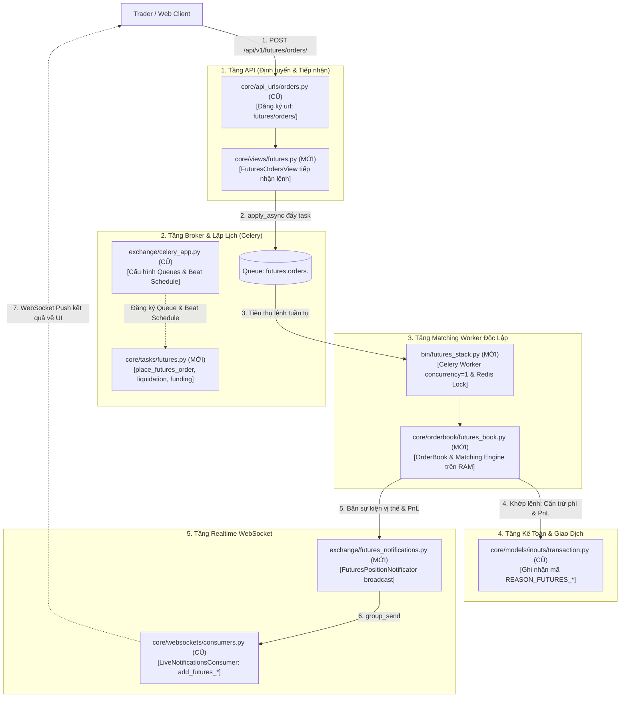

<p align="center">
  <a href="https://polygant.net/opencex/" target="_blank">
    
  </a>
</p>

<p align="center">
OpenCEX is a free and open source cryptocurrency exchange platform.<br>
Developed by <a href="https://polygant.net" target="_blank">Polygant</a>.  

<p align="center">
<a href="https://polygant.notion.site/OpenCEX-Help-Center-8cf8c842bde947c3818a615a88ceef9c" target="_blank">OpenCEX documentation</a> | <a href="https://t.me/opencex" target="_blank">Telegram chat</a>
</p>

> [!CAUTION]
> This repository is not maintained.  
> The code is provided as-is.

<p align="center"><b>Please go to the main repo to install OpenCEX <a href="https://github.com/Polygant/OpenCEX/">https://github.com/Polygant/OpenCEX/</a></b></p>

## Can I hire you guys?

OpenCEX was created and backed by Polygant, and is supported through all the years. You can request a consultation or order web and mobile development services by Polygant, just visit our site. 😎

Say hi: [hello@polygant.net](mailto:hello@polygant.net) . We will be happy to work with you!

## License
Apache License, Version 2.0

---

## 📚 KIẾN TRÚC & HƯỚNG DẪN MÔ PHỎNG LONG / SHORT (FUTURES EXCHANGE)
> *Tài liệu hướng dẫn đào tạo sinh viên về kiến trúc mở rộng từ sàn Spot sang Phái sinh (Futures).*

### 1. Bản Đồ Vị Trí Các Module Phái Sinh Mới

| Module / Thành phần | Vị trí File trong Backend | Nhiệm vụ Kiến trúc (Sinh viên học được gì) |
| :--- | :--- | :--- |
| **Matching Engine** | `core/orderbook/futures_book.py` | Sổ lệnh phái sinh, thuật toán khớp Long/Short, tính Margin, Giá thanh lý và Lãi/Lỗ (PnL) trên RAM. |
| **Worker Khớp Lệnh** | `bin/futures_stack.py` | Celery Worker độc lập (`concurrency=1`), lấy khóa phân tán `FuturesStackLock` trên Redis và nạp vị thế từ DB vào RAM. |
| **Background Tasks** | `core/tasks/futures.py` | 4 Celery tasks cốt lõi: Nhận lệnh (`place_futures_order`), Quét thanh lý (`check_liquidations`), Oracle giá (`update_mark_price`), Tính phí Funding (`settle_funding_rate`). |
| **Market Maker Bot** | `bots/futures_mm.py` | Bot tạo thanh khoản mồi: tự động treo 2 nhánh Bid (Long) và Ask (Short) quanh giá tham chiếu Mark Price. |
| **WebSocket Notifier** | `exchange/futures_notifications.py` | Đẩy dữ liệu thời gian thực ra giao diện: Cập nhật vị thế/PnL cho user, nhịp giá Mark Price và cảnh báo cháy vị thế. |
| **Master Simulation** | `bin/run_futures_simulation.py` | Script All-in-One chạy kịch bản hoàn chỉnh qua 6 giai đoạn để sinh viên quan sát toàn bộ vòng đời lệnh Futures. |

---

### 2. Hướng Dẫn Chạy Thử Nghiệm Mô Phỏng (Console / Log)

Sinh viên đứng tại thư mục `backend/` và thực thi các câu lệnh:

#### a. Chạy Toàn Bộ Vòng Đời Lệnh Futures (Khuyến nghị):
```bash
python3 bin/run_futures_simulation.py
```
> **Kịch bản tự động diễn ra qua 6 giai đoạn với log màu trực quan**:
> * **Giai đoạn 1**: Worker `futures_stack.py` khởi động, acquire Distributed Lock trên Redis.
> * **Giai đoạn 2**: Bot MM treo thanh khoản Short ở giá 65,032.50 USDT.
> * **Giai đoạn 3**: Trader đặt Long x20 $\rightarrow$ Khớp lệnh $\rightarrow$ Tạo `Position` $\rightarrow$ Bắn WebSocket PnL.
> * **Giai đoạn 4**: Oracle cập nhật giá tăng lên 66,500 $\rightarrow$ Bắn WebSocket PnL xanh (+45.13% ROE).
> * **Giai đoạn 5**: Celery Beat 8h kích hoạt trừ phí Funding Rate cấn trừ giữa 2 phe.
> * **Giai đoạn 6**: Thị trường rơi tự do xuống 61,900 $\rightarrow$ Liquidation Worker phát hiện chạm ngưỡng cháy $\rightarrow$ Ép bán đóng vị thế.

#### b. Chạy Thử Nghiệm Độc Lập Từng Module:
* **Kiểm tra thuật toán khớp lệnh & tính Margin**:
  ```bash
  python3 core/orderbook/futures_book.py
  ```
* **Kiểm tra quy trình khởi động Worker Khớp lệnh**:
  ```bash
  python3 bin/futures_stack.py --pairs=BTC-USDT-PERP
  ```
* **Kiểm tra các Celery Tasks nền (Quét thanh lý & Funding)**:
  ```bash
  python3 core/tasks/futures.py
  ```
* **Kiểm tra Bot tạo thanh khoản MM**:
  ```bash
  python3 bots/futures_mm.py
  ```
* **Kiểm tra Bộ phát tin WebSocket**:
  ```bash
  python3 exchange/futures_notifications.py
  ```

---

### 3. Sơ Đồ Tóm Tắt Điểm Nối Giữa Code Cũ và Code Mới (Bridging Map)

Sơ đồ dưới đây minh họa chi tiết cách mà các file hệ thống CŨ bắt tay và kích hoạt các module MỚI:



#### Bảng Đối Chiếu Điểm Nối Trực Tiếp:

| File CŨ Được Cập Nhật | Đoạn Code Can Thiệp | Gọi / Kích Hoạt File MỚI Nào? | Mục Đích Kết Nối |
| :--- | :--- | :--- | :--- |
| **`core/api_urls/orders.py`** | Cuối file `urlpatterns` | `core/views/futures.py` | Mở endpoint tiếp nhận `POST /api/v1/futures/orders/`. |
| **`exchange/celery_app.py`** | Khối `if is_section_enabled('futures'):` | `core/tasks/futures.py` | Đăng ký hàng đợi `futures_liquidation`, `futures_funding` và kích hoạt lịch Celery Beat chạy Funding Rate 8h/lần. |
| **`core/models/inouts/transaction.py`** | Khối hằng số `REASON_*` (dòng 50+) | Được gọi từ `core/orderbook/futures_book.py` | Cho phép hệ thống kế toán ghi nhận các loại giao dịch ký quỹ, funding, lãi/lỗ và thanh lý. |
| **`core/websockets/consumers.py`** | Hàm `receive_json()` trong `LiveNotificationsConsumer` | Được bắn tới bởi `exchange/futures_notifications.py` | Cho phép Client đăng ký nghe kênh `user_positions_{user_id}` và nhận nhịp giá `futures_mark_price`. |

---

### 4. Các Bài Toán Cốt Lõi Cần Giải Quyết Khi Triển Khai Long / Short Thực Tế

Khi phát triển tính năng Long/Short vào thực tế, bắt buộc phải giải quyết các bài toán kỹ thuật sau để tránh sập hệ thống hoặc sàn bị vỡ nợ:

* **Bài toán 1: Thanh khoản & Đối tác khớp lệnh (Counterparty & Hedging)**:
  * Khi sàn mới mở, không có người Short đối ứng khi người dùng muốn Long.
  * Nếu sàn tự đứng ra ôm lệnh (mô hình B-Book), khi thị trường tăng mạnh thì toàn bộ user Long thắng tiền $\rightarrow$ Sàn sẽ vỡ nợ nếu không có hàng chục triệu USD dự phòng.
  * *Giải pháp*: Cần xây dựng **Hedging Engine (A-Book)** tự động forward khối lượng mở ròng (Net Open Interest) sang Binance/Bybit để phòng hộ rủi ro, kết hợp Bot MM tạo thanh khoản hai đầu.

* **Bài toán 2: Hiệu năng tính PnL và Quét thanh lý trên In-Memory/Redis (Tránh nghẽn DB)**:
  * Khác với Spot, ở Futures chỉ cần giá thị trường nhích $1, hàng ngàn vị thế đang mở đều biến động Lãi/Lỗ và tỷ lệ ký quỹ.
  * Nếu mỗi tick giá đều truy vấn `SELECT` / `UPDATE` vào PostgreSQL $\rightarrow$ Database sẽ quá tải (CPU 100%, cạn kiệt IOPS).
  * *Giải pháp*: Toàn bộ vị thế và mức giá thanh lý (`liquidation_price`) phải được lập chỉ mục trong RAM hoặc `Sorted Set (ZSET)` của Redis. Chỉ quét trên Redis, khi vị thế bị đóng mới ghi log xuống DB.

* **Bài toán 3: Nguồn cấp giá đánh dấu (Mark Price Oracle) Chống Thao Túng Giá**:
  * Tuyệt đối không dùng giá khớp nội bộ trên sàn để tính thanh lý vì sổ lệnh sàn mới mỏng, kẻ xấu có thể nạp ít tiền xả mạnh để cố tình săn thanh lý (Liquidation Hunting) của người khác.
  * *Giải pháp*: Kết nối WebSocket lấy giá Spot từ 3 sàn lớn (Binance, OKX, Bybit), tính giá trung vị (Median Index Price) và cộng EMA Basis để sinh ra **Mark Price**.

* **Bài toán 4: Cơ chế Thanh lý (Liquidation), Quỹ Bảo Hiểm (Insurance Fund) & ADL**:
  * Khi thị trường rơi tự do (Flash Crash), việc bán tháo vị thế cháy có thể bị trượt giá sâu làm tài khoản user bị âm tiền (Bad Debt).
  * *Giải pháp*: Bắt buộc phải có **Quỹ Bảo Hiểm** để bù đắp các khoản lỗ trượt giá này, và cơ chế **ADL (Auto-Deleveraging)** tự động giảm bớt vị thế của phe đang có lãi nhiều nhất để bảo toàn sàn nếu Quỹ Bảo Hiểm cạn tiền.

* **Bài toán 5: Phân tách Ví An toàn (Isolated Wallet vs Spot Wallet)**:
  * Tuyệt đối không dùng chung bảng `Balance` của Spot cho Futures.
  * Phải tách riêng bảng `FuturesBalance`. Người dùng muốn chơi Long/Short phải bấm "Chuyển tiền" từ ví Spot sang ví Futures để bảo vệ tài sản không bị thanh lý chéo.

* **Bài toán 6: Chống Race Condition / Double Settlement Trên Vị Thế**:
  * Nguy cơ người dùng bấm đóng lệnh bằng tay đúng vào tích tắc Liquidation Worker cũng đang ép thanh lý.
  * *Giải pháp*: Áp dụng khóa `select_for_update()` kết hợp trường `version` (Optimistic Locking) trên bảng `Position` để đảm bảo không bị thanh lý trùng lặp.

* **Bài toán 7: Lựa chọn Mô hình Ký Quỹ Ban Đầu (Isolated Margin Trước)**:
  * Khi mới phát triển, chỉ nên triển khai **Isolated Margin** (ký quỹ cô lập trên từng lệnh: cháy lệnh nào mất tiền lệnh đó). Chưa nên làm Cross Margin ngay để tránh rủi ro sụp đổ dây chuyền tài khoản.

